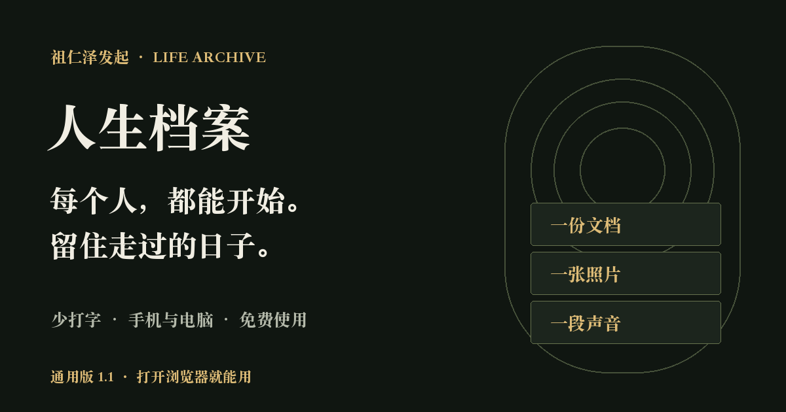

# 人生档案（Life Archive）

**每天说几句，把经历、读书收获和创作灵感，积累成能查找、能回看的个人知识。**

免费开源 · 本地保存 · 无需注册 · MIT 许可。由 [祖仁泽](https://zurenze1.github.io/life-archive/author/) 发起，面向每一个使用者。

[下载 Mac 版](https://github.com/zurenze1/life-archive/releases) · [语音日记说明](docs/VOICE_JOURNAL.md) · [手机联动与隐私](docs/SYNC_AND_PRIVACY.md) · [网页版 1.3](https://zurenze1.github.io/life-archive/app/)



## 是什么？

人生档案 1.4 是一款 **语音日记与个人知识积累工具**。你主动说、写或导入自己的笔记，它保存原文、原始录音和时间，另外生成可以回到原句的整理结果。它不再把“打开了哪个软件”作为记录主体，也不在后台扫描文件或浏览记录。

## 为什么做？

有价值的往往是一闪而过的想法、读书时的领悟、做一件事的经验。它们容易忘；日记又容易因为打字麻烦、没话写而中断。

人生档案希望把这件事做得简单：**用说话降低记录负担，用原文保证真实，用搜索、补充和高亮把经历变成日后能用的知识。** 累积的素材也可用于创作和个人 IP，但不会自动替你编故事、推测性格或下人生结论。

## 能解决什么问题？

| 问题 | 1.4 的做法 |
| --- | --- |
| 忘写日记，打字麻烦 | 默认每晚 21:00 全屏强提醒；语音记录，没话说时跟随问题；开关、时间和强度可调整 |
| 说话零散，担心 AI 曲解 | 录音与原文保留；另外按问题归类，省略完全重复句与独立语气词，每条都有原句依据 |
| 写过就找不到 | 按关键词、日期、主题查找，查看日期索引；原文命中处显示上下文 |
| 过几天还想补充 | 打开旧日记“继续补充”，自动记下补充时间，原内容保留；选中文字高亮 |
| 经验沉淀不下来 | 将原话留为知识卡片，保留来源；日记、补充、高亮与录音可同步到自己的 Obsidian |
| 手机突然有灵感 | 扫电脑中的配对码打开随手记，手机先保存；连接电脑后补传，支持文字与声音 |
| 重要信息散落 | 独立本地加密保险箱，存重要事件、个人信息与密码，自己设置主密码 |
| 怕软件更新上传私人资料 | 更新器只下载 GitHub 软件包；档案和保险箱在应用之外的本机目录，没有 GitHub 数据上传功能 |

## 怎么用？

1. 在 [Releases](https://github.com/zurenze1/life-archive/releases) 下载适合 Apple 芯片 Mac 的正式包，放入“应用程序”。打开后直接使用，无需注册。
2. 点击“直接说几句”或“用文字补充”。语音需要先准备本地 FunASR 环境；识别未就绪时会明确提示，录音仍会保存。[配置方法](docs/VOICE_JOURNAL.md#本地语音识别)。模型权重未包含在安装包中。
3. 核对识别文字，预览整理，再保存。到“我的日记”按日期或关键词找回；可以继续补充、标高亮、留为知识卡片。
4. 在“提醒与备份”选择 Obsidian 知识库，之后保存和补充自动同步。手动补充区保留；发现人工改动时生成待合并文件，不覆盖。
5. 在“手机随手记”开启接收并显示配对二维码。普通 Wi-Fi 地址需要页面保持可用；要支持外出即时同步与断网重开，按 [私人 HTTPS 配置](docs/SYNC_AND_PRIVACY.md) 设置。
6. 密码等放“重要信息”保险箱，设置自己的主密码。它不会同步 Obsidian 或手机。主密码无法找回，请自行保管。
7. 定期导出完整备份。软件可自动检查与下载更新，校验后点击重启安装。

**电脑睡眠、关机时无法准点提醒或立即接收；手机关闭页面后的后台同步受安卓系统限制。** 普通 HTTP 地址不能提供可靠的离线网页重开；HTTPS 随手记联网首次载入后支持缓存页面。当前没有安卓原生 APK，也没有手机实机验收结论。

## 个人数据在哪里？

- Mac：`~/Library/Application Support/人生档案/data/`，包含 SQLite、录音与主动导入文件。数据不在源码仓库或程序安装目录里。
- Obsidian：你选择的知识库内 `人生档案/日记/YYYY/YYYY-MM-DD.md`，录音单独保存。仅本机日记、识别出凭据格式的内容与保险箱不参与同步。检测不能保证识别所有敏感内容，含隐私时请主动勾选“仅保存在人生档案”。
- 手机：当前浏览器 IndexedDB。配对链接只允许向电脑发送新记录，不提供读取整份档案或保险箱的接口；不要分享配对链接。
- 保险箱：独立 AES-256-GCM 加密文件，scrypt 从主密码派生密钥。闲置五分钟、锁屏或退出时锁定；备份保留密文，跨电脑恢复仍需主密码。
- GitHub：公开源码与程序包。更新请求只读取本项目 Release 并下载软件，不发送日记、录音、保险箱或设备文件。

这是一款个人记录工具；保险箱没有经过独立安全审计，不宣称替代经过成熟审计的专用密码管理器。没有自动人格诊断，也不会因为你浏览、计划或谈及某件事就认定已经完成。

## 版本说明

本仓库桌面源码为 **1.4.0**。公开 [通用网页版](https://zurenze1.github.io/life-archive/app/) 仍为 **1.3**，与新桌面版功能和数据独立，不会自动合并。具体安装包以 Releases 实际发布列表为准。旧资料已保留迁移备份，新版停止自动采集；只有应用使用日志在备份后退出日常档案。

## 源码运行

需要 Node.js 24+、npm 和 Mac。

```sh
git clone https://github.com/zurenze1/life-archive.git
cd life-archive
npm ci
npm test
npm start
```

如果安装环境跳过了 Electron 下载脚本，运行 `node node_modules/electron/install.js` 后再启动。执行 `npm run package` 构建 arm64 的 DMG 与 ZIP。

测试使用临时数据库和合成材料，不修改真实浏览器资料库。验证结果见 [测试记录](docs/TESTING.md)。

## 开源参考与贡献

借鉴 [Memos](https://github.com/usememos/memos) 的轻量记录思路与 [voice-memo-to-obsidian](https://github.com/mobob/voice-memo-to-obsidian) 的转写分区思路；没有搬入它们的云端上传流程。实际语音识别使用 [FunASR](https://github.com/modelscope/FunASR) / [SenseVoice](https://github.com/QwenAudio/SenseVoice)，权重许可独立于本项目 MIT 代码许可。二维码使用 [node-qrcode](https://github.com/soldair/node-qrcode)。

问题和建议请提交 [Issue](https://github.com/zurenze1/life-archive/issues)，不要附带私人日记、密码或完整数据库。详细能力边界见版本文档；网页 1.3 的旧功能说明不代表桌面 1.4 仍采集设备活动。
